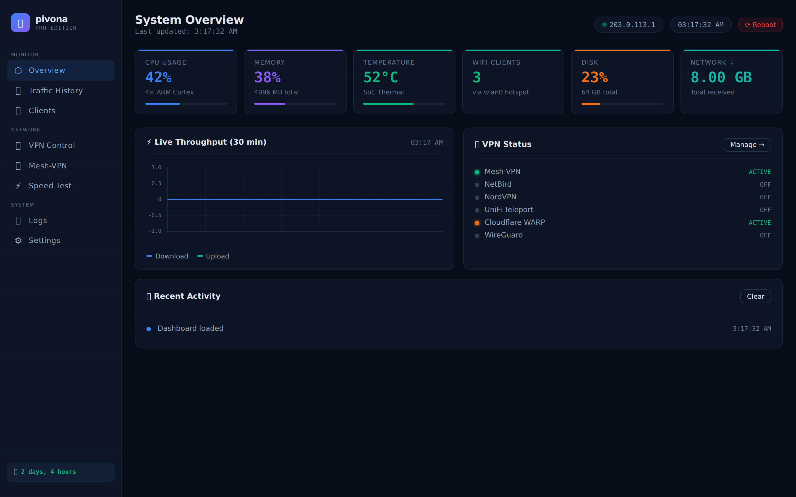
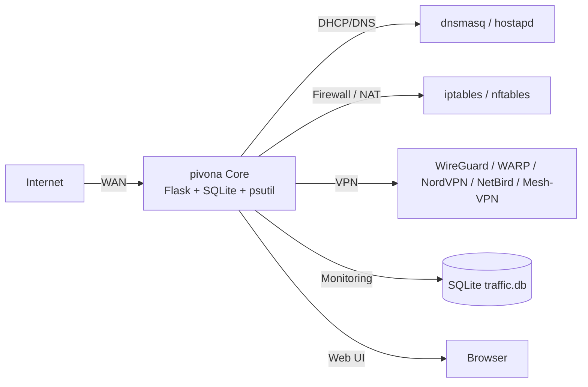

<div align="center">


# pivona

**A professional Raspberry Pi router dashboard** — manage routing, firewall, DHCP, DNS, multi-VPN tunnels, and live traffic from one dark-theme web UI, for Pi 4/5 gateways. Formerly **PiRoute**.

<a href="https://github.com/OneByJorah/pivona/stargazers"></a>
<a href="https://github.com/OneByJorah/pivona/commits"></a>
<a href="https://github.com/OneByJorah/pivona/actions/workflows/ci.yml"></a>
<a href="LICENSE"></a>


</div>



## What This Is

Turning a Raspberry Pi into a router usually means juggling `iptables`, `dnsmasq`, `wg-quick`, and a pile of shell scripts. pivona wraps those into a single Flask-backed dashboard with a REST API, so you can see system health, edit rules, control VPN tunnels, and run a speed test without a terminal. It targets Pi 4/5 hardware running Raspberry Pi OS.

The repository ships with a **demo mode** so you can preview the dashboard locally without giving a container real network privileges.

## Quick Start (Demo)

The fastest way to see the dashboard is Docker Compose in demo mode:

```bash
git clone https://github.com/OneByJorah/pivona.git
cd pivona
cp .env.example .env
docker compose up -d --build
```

Wait a few seconds, then check the health endpoint:

```bash
curl http://127.0.0.1:5000/healthz
# {"demo": true, "status": "ok"}
```

Open **http://127.0.0.1:5000**. The dashboard shows demo data so you can explore the UI safely.

To stop and clean up:

```bash
docker compose down -v
```

## Features

- **Routing** — iptables/nftables rule management, NAT, and port forwarding.
- **Firewall** — visual rule editor with preset profiles and real-time logging.
- **DHCP** — lease management via `dnsmasq` leases, with static assignments.
- **DNS** — local caching resolver with configurable upstream forwarding.
- **Multi-VPN** — WireGuard · Cloudflare WARP · NordVPN · NetBird · Mesh-VPN · UniFi Teleport.
- **Traffic monitoring** — live 30-minute throughput plus 24h/3d/7d bandwidth history stored in SQLite.
- **Speed test** — in-dashboard internet speed measurement with history.
- **System telemetry** — CPU, memory, disk, and temperature gauges.
- **Client list** — connected devices with hostname, IP, and MAC.

## Configuration

| Variable | Default | Description |
|----------|---------|-------------|
| `FLASK_ENV` | `production` | Flask environment |
| `TZ` | `UTC` | Container timezone |
| `DEMO_MODE` | `true` in `.env.example` | `true` = safe preview with fake data; `false` = real router control |
| `DB_PATH` | `/var/lib/pivona/traffic.db` | SQLite database path inside the container |

Copy `.env.example` to `.env` and change `DEMO_MODE=false` only when running on an actual gateway with the privileges described below.

## Architecture



## Real Router Deployment (NET_ADMIN Required)

The quick start above runs in **demo mode** and deliberately does **not** ask for network privileges. On a real Raspberry Pi gateway pivona needs to manage host network interfaces, iptables/nftables, and VPN tunnels. Use a compose override or edit `.env` with `DEMO_MODE=false` and add the required capabilities:

```yaml
services:
  pivona:
    image: ghcr.io/onebyjorah/pivona:latest
    env_file: .env
    network_mode: host
    privileged: true
    cap_add:
      - NET_ADMIN
      - NET_RAW
    volumes:
      - pivona_data:/var/lib/pivona
```

> [!WARNING]
> `NET_ADMIN`, `NET_RAW`, host networking, and often `privileged` are required for real router features. Do not enable these on a general-purpose machine; deploy only on a dedicated gateway host.

## Dashboard Pages

| Page | Description |
|------|-------------|
| **System Overview** | Real-time CPU, memory, disk, temp, network stats with live throughput chart |
| **Traffic History** | Bandwidth, CPU, temperature, clients, memory — 24h/3d/7d views |
| **WiFi Clients** | Connected DHCP clients with hostname, IP, MAC |
| **VPN Control** | Start/stop individual VPN tunnels with status indicators |
| **Mesh-VPN** | Exit node selection for the Mesh-VPN network |
| **Speed Test** | Internet speed measurement with history tracking |
| **System Logs** | Live log viewer for all services |
| **Settings** | Hotspot configuration, system actions, reboot |

## API Endpoints

| Endpoint | Method | Description |
|----------|--------|-------------|
| `/api/stats` | GET | Current system + VPN stats |
| `/api/traffic` | GET | Traffic history (period query) |
| `/api/clients` | GET | Connected DHCP clients |
| `/api/vpn/<action>/<service>` | POST | Start/stop a VPN service |
| `/api/mesh-vpn/exit-nodes` | GET | List mesh exit nodes |
| `/api/mesh-vpn/set-exit` | POST | Set the mesh exit node |
| `/api/speedtest` | GET | Run a speed test |
| `/api/logs` | GET/POST | Read service logs |
| `/api/reboot` | POST | Reboot the host |
| `/healthz` | GET | Health probe |

## Project Structure

```
pivona/
├── app.py                 # Flask application (API + dashboard)
├── wsgi.py                # Gunicorn entrypoint with background thread
├── template/dashboard.html# Single-page dashboard UI
├── init_db.py             # Database initialization
├── start.sh               # Startup script (init DB + run app)
├── docker-compose.yml     # Docker deployment (demo mode by default)
├── Dockerfile             # Production image
├── docker-entrypoint.sh   # Container entrypoint
├── requirements.txt       # Python dependencies
├── pyproject.toml         # Package metadata
├── scripts/               # Utility scripts (screenshots)
├── systemd/               # systemd service files
├── docs/assets/           # Banner, screenshots
└── README.md
```

## Use Cases

1. **Home-lab gateway** — replace a consumer router UI with something scriptable and self-hosted.
2. **Travel router** — flip between WARP, WireGuard, and NordVPN from one panel.
3. **Network learning** — inspect live iptables/nftables and DHCP behavior on real hardware.

## Tech Stack

Python 3.11+ · Flask · SQLite · psutil · Chart.js · HTML5/CSS3 · iptables/nftables · dnsmasq · hostapd · WireGuard/WARP/NordVPN/NetBird · Docker · systemd · Raspberry Pi OS

## Screenshots

Screenshots are captured from the real running dashboard in demo mode. See [`docs/screenshots/`](docs/screenshots/).

| View |
|---|
|  |

## Contributing

Contributions are welcome. See [CONTRIBUTING.md](CONTRIBUTING.md) and [CODE_OF_CONDUCT.md](CODE_OF_CONDUCT.md). [Open an issue](https://github.com/OneByJorah/pivona/issues).

## License

MIT — see [LICENSE](LICENSE).

## Connect

- [jorahone.com](https://jorahone.com)
- [GitHub Org](https://github.com/OneByJorah)
- [info@jorahone.com](mailto:info@jorahone.com)
